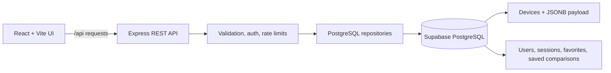

# SpecMine

SpecMine is a modern, full-stack web application that lets users intelligently search, explore, and compare the technical specifications of electronic devices. It bridges the gap between complex hardware details and a clean, user-friendly interface, simplifying the consumer decision-making process.

> **Production-minded foundation:** SpecMine includes a paginated catalog API, parameterized database access, request correlation IDs, JSON observability logs, hardened headers, per-route rate limits, database-backed health checks, database indexes, automated tests, and a GitHub Actions quality gate.

## Key Features

- **Advanced Device Search:** Quickly locate specific devices by brand name, model number, or product category using an interactive search bar with live autocomplete suggestions.
- **Multi-Category Browsing:** Seamlessly navigate through six categories — Smartphones, Laptops, Tablets, Earbuds, Headphones, and Televisions — each with dedicated pages and sidebar navigation.
- **Side-by-Side Comparisons:** Compare up to three devices simultaneously with a detailed spec table that highlights the "best value" for each specification (e.g., highest RAM, lowest price) using a custom heuristic scoring engine.
- **Shareable Comparisons:** Share a comparison URL that restores up to three devices and handles unavailable catalog entries gracefully.
- **Recently Viewed:** Revisit the eight most recent device details on the same browser, stored as a versioned list of IDs.
- **Detailed Specifications:** Access structured data for every device, covering processor/chipset, RAM/storage, display, battery, camera, connectivity, and more.
- **Specification Completeness:** See how many source fields contain recorded values, without filling missing data with estimates.
- **User Authentication:** Register and log in with database-backed opaque sessions and scrypt password hashing.
- **Dark / Light Theme:** A class-based dark mode toggle powered by Tailwind CSS, with the preference persisted in `localStorage`.
- **Responsive Design:** Tailwind layouts support desktop and mobile browsing.

## Technology Stack

| Layer | Technology |
|---|---|
| Frontend Framework | React 19 (bootstrapped with Vite 7) |
| Routing | React Router DOM 7 |
| Styling | Tailwind CSS 3 (class-based dark mode) |
| Icons | react-icons (Feather & Font Awesome) |
| Spinner | react-spinners (FadeLoader) |
| Backend Runtime | Node.js (ES Modules) |
| Backend Framework | Express 5 |
| Database | PostgreSQL (via `pg` driver; Supabase in production) |
| Auth | Opaque database-backed sessions + scrypt password hashing (Node `crypto`) |
| Frontend Deployment | Vercel (or Netlify) |
| Backend Deployment | Render (or Vercel serverless) |
| Database Hosting | Supabase |

## Architecture



The frontend uses the same `/api` paths in development and production. Vite proxies locally; deployments can route through the Vercel function or set `VITE_API_BASE_URL` to a separate API host. See [API documentation](docs/API_DOCUMENTATION.md) and [database schema](docs/DATABASE_SCHEMA.md).

## Project Structure

- `api/[...path].js` routes Vercel API requests to Express.
- `backend/` contains the Express app, config, controllers, middleware, repositories, routes, scripts, tests, validators, utilities, and `data/db.json`.
- `frontend/src/` contains the React API clients, components, contexts, pages, services, and utilities.
- `supabase/migrations/` contains the versioned PostgreSQL schema changes.
- `docs/API_DOCUMENTATION.md` and `docs/DATABASE_SCHEMA.md` document the implemented API and schema.
- `render.yaml`, `vercel.json`, and `netlify.toml` contain deployment configuration for their respective targets.

## Getting Started

### Prerequisites

- **Node.js** v22 (used by CI and the Render blueprint)
- **PostgreSQL** database (local install or a Supabase project)

### Installation

1. **Clone the repository:**
   ```bash
   git clone https://github.com/aditya123000/CompareDevicesApp.git
   cd CompareDevicesApp
   ```

2. **Install root dependencies** (includes `concurrently` for running both apps):
   ```bash
   npm install
   ```

3. **Install backend dependencies:**
   ```bash
   npm install --prefix backend
   ```

4. **Install frontend dependencies:**
   ```bash
   npm install --prefix frontend
   ```

5. **Configure backend environment variables:**
   ```bash
   cp backend/.env.example backend/.env
   ```
   Configure `backend/.env` with your PostgreSQL credentials. The active auth flow uses database-backed sessions; `JWT_SECRET` is only referenced by an unused legacy helper. By default, the server connects via `host: localhost`, `port: 5432`, `user: postgres`, and `database: compare_devices`. Set `PGPASSWORD` to your local Postgres password.

6. **Set up the database:**
   - Apply the SQL files in [`supabase/migrations`](supabase/migrations) in numeric order before starting the application.
   - Startup also runs idempotent table/index setup, but it does not track migration versions. Use the numbered migrations as the schema history, especially for hosted databases.

7. **Start the development servers:**
   ```bash
   npm run dev
   ```
   This uses `concurrently` to start:
   - The **backend** on port `8000` (via `nodemon`)
   - The **frontend** Vite dev server on port `5173`

   The Vite dev server proxies `/api` requests to `http://localhost:8000`, so no `VITE_API_BASE_URL` is needed in development.

8. **Open the app:** Navigate to `http://localhost:5173`.

> **Alternative:** You can also start the backend and frontend separately:
> ```bash
> # Terminal 1 — backend
> npm run dev --prefix backend
>
> # Terminal 2 — frontend
> npm run dev --prefix frontend
> ```

## API Endpoints

See [API_DOCUMENTATION.md](docs/API_DOCUMENTATION.md) for request parameters, validation rules, response and error formats, and examples.

| Method | Path | Auth | Description |
|---|---|---|---|
| GET | `/` | No | HTML landing page |
| GET | `/api/health` | No | Health check → `{ status: "ok" }` |
| GET | `/api/devices` | No | Paginated catalog with data/meta; supports page, limit, q, brand, category, availability, maxPrice, minRam, and sort (`relevance`, `price_asc`, `price_desc`, `ram_desc`, `year_desc`) |
| GET | `/api/devices/brands?category=phones` | No | Brand options for a device category |
| GET | `/api/devices/:id` | No | One device with a data envelope |
| POST | `/api/auth/register` | No | Register with a data envelope containing token, expiry, and user |
| POST | `/api/auth/login` | No | Login with a data envelope containing token, expiry, and user |
| GET | `/api/auth/me` | Yes (Bearer) | Current user with a data envelope |
| POST | `/api/auth/logout` | Yes (Bearer) | Revoke current session; returns 204 |
| PUT | `/api/auth/profile` | Yes (Bearer) | Update account name/email |
| PUT | `/api/auth/password` | Yes (Bearer) | Change password and revoke sessions |
| GET/POST/DELETE | `/api/library/favorites[/:deviceId]` | Yes (Bearer) | List, add, remove favorites |
| GET/POST/DELETE | `/api/library/comparisons[/:comparisonId]` | Yes (Bearer) | List, save, remove comparisons |

## Environment Variables

### Backend (`backend/.env`)

| Variable | Purpose |
|---|---|
| `PORT` | Backend server port (default `8000`) |
| `CORS_ORIGIN` | Comma-separated allowed origins; exact production origins are preferred |
| `JWT_SECRET` | Legacy custom JWT helper only; not used by active authentication routes |
| `DATABASE_URL` | PostgreSQL connection string (preferred for production) |
| `PGHOST` | PostgreSQL host (if not using `DATABASE_URL`) |
| `PGPORT` | PostgreSQL port (default `5432`) |
| `PGDATABASE` | Database name (default `compare_devices`) |
| `PGUSER` | PostgreSQL user (default `postgres`) |
| `PGPASSWORD` | PostgreSQL password |
| `PG_SSL` | SSL preference: `true`/`false` (default `false`; set `true` for Supabase) |
| `AUTO_SEED_DB` | Optional local seed from `db.json` when the table is empty (default `false`; production startup seeding is prohibited) |
| `SEED_REPLACE_CONFIRM` | Must equal `replace-device-catalog` to run the destructive catalog replacement script; leave unset otherwise |

### Frontend (`frontend/.env`)

| Variable | Purpose |
|---|---|
| `VITE_API_BASE_URL` | API base URL. Leave empty for same-origin (Vercel serverless). Set to Render URL for split deployment. |

## Deployment

This repo supports two deployment strategies:

### Option A: Monorepo on Vercel (Frontend + Serverless API)

Deploy the entire project as a single Vercel site. The frontend builds from `frontend/` and the API runs as Vercel serverless functions via [`api/[...path].js`](api/[...path].js), which imports the Express app from `backend/app.js`.

- **Build command:** `npm run build --prefix frontend`
- **Publish directory:** `frontend/dist`
- **Environment variables (Vercel):**
  - `VITE_API_BASE_URL` — leave empty (same-origin)
  - `DATABASE_URL` — Supabase connection string
  - `JWT_SECRET` — optional; referenced only by an unused legacy helper, not active authentication
  - `CORS_ORIGIN` — your Vercel URL(s)
  - `PG_SSL=true`
  - `AUTO_SEED_DB=false`

The [`vercel.json`](vercel.json) file handles SPA routing (filesystem-first, then fallback to `index.html` for non-`/api/` paths).

### Option B: Split Deployment (Vercel + Render + Supabase)

#### 1. Supabase (Database)

- Create a new Supabase project.
- In **Project Settings → Database**, copy the Postgres connection string.
- In Supabase, either:
  - apply all SQL files under [`supabase/migrations`](supabase/migrations) in numeric order.
- Use the database password/connection string in Render as `DATABASE_URL`.
- Keep `PG_SSL=true` in production.

#### 2. Render (Backend API)

- This repo includes [`render.yaml`](render.yaml) for the backend service.
- Create a new Render Blueprint or Web Service from the repo.
- Render should deploy from the `backend/` directory with:
  - build command: `npm ci`
  - start command: `npm start`
- Set these environment variables in Render:
  - `DATABASE_URL`
  - `JWT_SECRET` (optional legacy helper; not used by active authentication)
  - `CORS_ORIGIN`
  - `PG_SSL=true`
  - `AUTO_SEED_DB=false`
- Point `CORS_ORIGIN` to your Vercel site URL. You can also include localhost while testing, for example:
  - `http://localhost:5173,https://your-site.vercel.app`
  - Add exact preview origins when needed; avoid broad wildcards for production unless every matching origin is trusted.

#### 3. Vercel (Frontend)

- This repo includes [`vercel.json`](vercel.json) for the frontend build.
- Create a new Vercel site from the repo.
- Use:
  - build command: `npm run build --prefix frontend`
  - publish directory: `frontend/dist`
- Set this environment variable in Vercel:
  - `VITE_API_BASE_URL=https://your-render-service.onrender.com`
- The frontend reads that value through [`frontend/src/Api/apiBase.js`](frontend/src/Api/apiBase.js), so API requests go to Render in production and still use the local Vite proxy during development.

### Alternative: Netlify (Frontend)

The repo also includes [`netlify.toml`](netlify.toml), configured to build and publish the frontend from `frontend/`. Netlify hosts only the frontend here; set `VITE_API_BASE_URL` to a separately deployed API (for example Render) and allow the Netlify origin in the backend's `CORS_ORIGIN`.

These instructions describe repository configuration; no live Vercel, Render, Netlify, or Supabase deployment is claimed as verified by local checks.

## Available Scripts

### Root (`package.json`)

| Command | Description |
|---|---|
| `npm run dev` | Start both backend and frontend concurrently (backend on `:8000`, frontend on `:5173`) |
| `npm install` | Install root dev dependencies (`concurrently`) |
| `npm test` | Run backend and frontend unit tests |
| `npm run lint` | Run frontend ESLint |
| `npm run build` | Build the production frontend |

### Backend (`backend/package.json`)

| Command | Description |
|---|---|
| `npm start` | Start backend server (`node app.js`) |
| `npm run dev` | Start backend with auto-reload (`nodemon app.js`) |
| `npm run seed` | Destructively replace all devices from `data/db.json`; requires `SEED_REPLACE_CONFIRM=replace-device-catalog` |
| `npm run import:mobiles` | Import phone data from a CSV file into `data/db.json` |

### Frontend (`frontend/package.json`)

| Command | Description |
|---|---|
| `npm run dev` | Start Vite dev server (port `5173`) |
| `npm run build` | Build production frontend to `dist/` |
| `npm run preview` | Preview the production build |
| `npm run lint` | Run ESLint |
| `npm test` from the repository root | Run backend and frontend unit tests |

## Database Schema

The database contains `devices`, `users`, `user_sessions`, `user_favorites`, and `saved_comparisons`. See [DATABASE_SCHEMA.md](docs/DATABASE_SCHEMA.md) for columns, foreign keys, indexes, migration behavior, and seed safety. Apply numbered SQL migrations in order before deploying. The backend performs idempotent startup table/index setup but does not track migration versions.

## Key Design Decisions

- **Device storage:** Common fields and legacy flat specification columns are retained alongside the JSONB `payload`. Migration 002 backfills payloads from existing flat fields without deleting catalog rows.
- **Defense-in-depth null handling:** Both backend and frontend filter out null/non-object devices, preventing crashes from bad data.
- **Database-backed sessions:** The active auth flow stores only hashes of opaque bearer tokens. A custom JWT utility remains in the repository but is not used by active auth routes.
- **scrypt password hashing:** Uses Node's built-in `crypto.scrypt` instead of bcrypt, avoiding native dependencies.
- **SSL fallback:** The database connection automatically retries with SSL enabled/disabled if the initial connection fails due to SSL mismatch.
- **Heuristic processor scoring:** The compare logic uses a custom scoring algorithm for processor names (Apple, Snapdragon, Dimensity, Exynos, Tensor) to enable "best processor" highlighting.
- **Split deployment support:** The project supports both same-origin deployment (Vercel serverless via `api/[...path].js`) and split deployment (frontend on Vercel, backend on Render).

## Future Roadmap

- Add valid-auth database integration tests and browser-level component tests.
- Consider shared rate-limit storage if the API is deployed across multiple instances.
- Measure catalog query plans at realistic data sizes before adding specialized indexes.
- Evaluate safer browser session transport and token storage.
- Add data provenance and a reviewed repeatable import/upsert workflow.
## Author

**Aditya**  
GitHub: [aditya123000](https://github.com/aditya123000)

⭐ *If you find this project helpful or interesting, please consider giving it a star on GitHub!*
