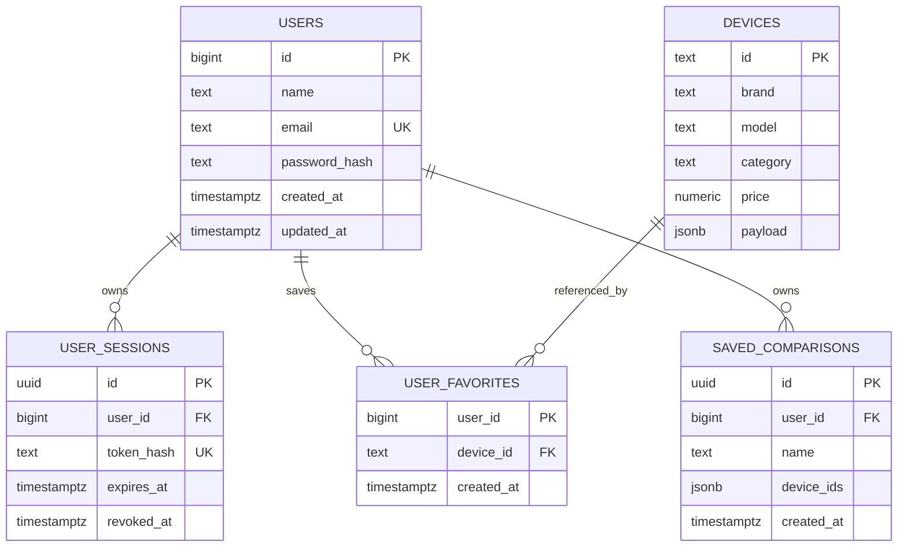

# Database Schema

PostgreSQL is the runtime source served by the API. The versioned SQL files under `supabase/migrations/` are the reviewable schema history. Apply migrations in numeric order to a fresh or existing database before deployment; the API's idempotent table setup is a bootstrap safeguard, not a replacement for reviewing migrations.

## Relationships

`saved_comparisons.device_ids` is JSONB, so it has no per-element foreign key. The API validates that IDs exist and belong to one category before saving. Device deletion can cascade through favorites; it does not rewrite saved comparison JSON.

## Tables

### `devices`

`id TEXT PRIMARY KEY`, `brand TEXT NOT NULL`, `model TEXT NOT NULL`, nullable `category TEXT`, `price NUMERIC`, and `payload JSONB NOT NULL`. Common query/display fields are also retained as nullable flat columns: `available`, `display`, `refreshRate`, `processor`, `ram`, `storage`, `camera`, `battery`, `charging`, `os`, `image`, `mobileWeight`, `frontCamera`, `backCamera`, and `launchedYear`.

The JSONB payload preserves category-specific attributes while flat columns support common filtering and sorting. Missing values stay missing; the application does not infer specifications.

### `users`

`id BIGINT` identity primary key; required `name`, unique required `email`, required `password_hash`, and required `created_at`/`updated_at` timestamps. Password hashes are generated with Node's `scrypt`; plaintext passwords are not stored.

### `user_sessions`

UUID primary key, user foreign key with `ON DELETE CASCADE`, unique token hash, expiration, optional revocation timestamp, and creation timestamp. Only opaque bearer-token hashes are stored.

### `user_favorites`

Composite primary key `(user_id, device_id)`, with cascading foreign keys to users and devices plus a creation timestamp. This prevents duplicate favorites.

### `saved_comparisons`

UUID primary key, cascading user foreign key, required name, JSONB array of two or three device IDs, and creation timestamp.

## Indexes

- Devices: brand, category, and `(brand, model, id)` catalog search/order index.
- Users: unique email constraint plus `idx_users_email`.
- Sessions: partial `(user_id, expires_at)` index for rows where `revoked_at IS NULL`.
- Favorites: composite primary key supports user/device lookups.
- Saved comparisons: primary key; user-owned listing is currently ordered by `created_at` and may merit a measured index as data grows.

The existing catalog search uses substring `ILIKE`, and RAM/year sorting extracts values from text. B-tree indexes do not accelerate every such operation. The current catalog is small; assess real query plans before adding trigram indexes, expression indexes, or schema changes.

## Migrations and startup

1. `001_initial_schema.sql` creates the current tables, common flat device fields, and baseline indexes for a fresh database.
2. `002_reconcile_legacy_device_schema.sql` is idempotent for legacy deployments: it adds missing flat fields and `payload`, backfills only rows whose payload is null from their existing columns, then enforces `payload NOT NULL`. It does not delete device rows.

The backend also runs `CREATE TABLE/INDEX IF NOT EXISTS` statements and ensures `users.updated_at` at startup. It does **not** track applied migration versions. Apply future migration files explicitly, review them first, and retain backups appropriate to the environment.

## Data loading safety

`AUTO_SEED_DB` defaults to `false` and is rejected when enabled in production. The optional startup seed only loads when the devices table is empty. The explicit `npm run seed --prefix backend` replacement truncates the device table and requires `SEED_REPLACE_CONFIRM=replace-device-catalog`; do not run it against production without an approved backup and replacement plan. Seed inputs are `backend/data/db.json`.
